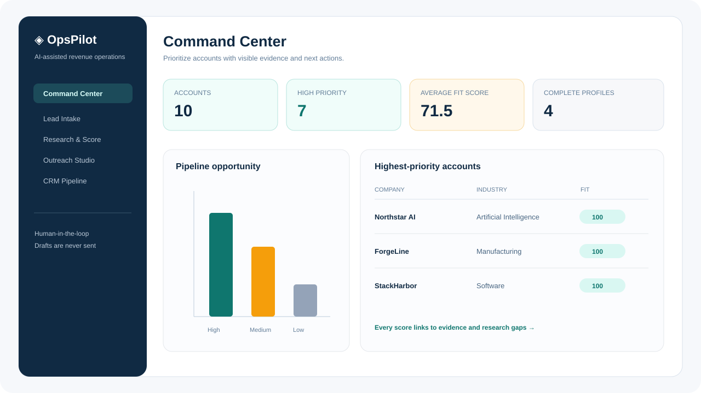
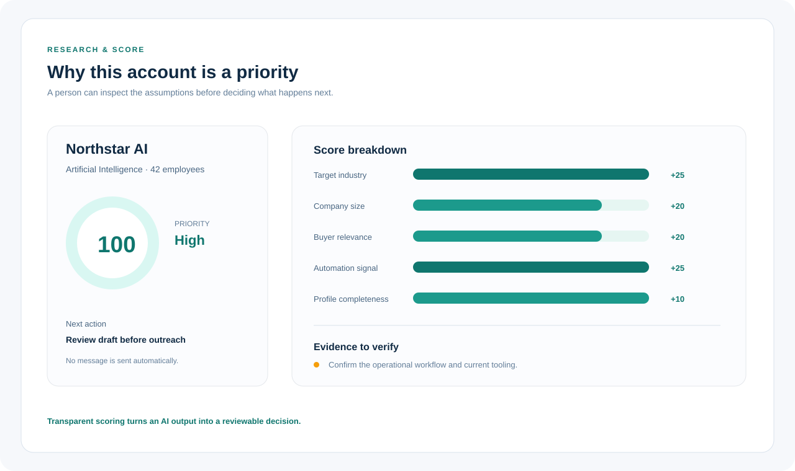
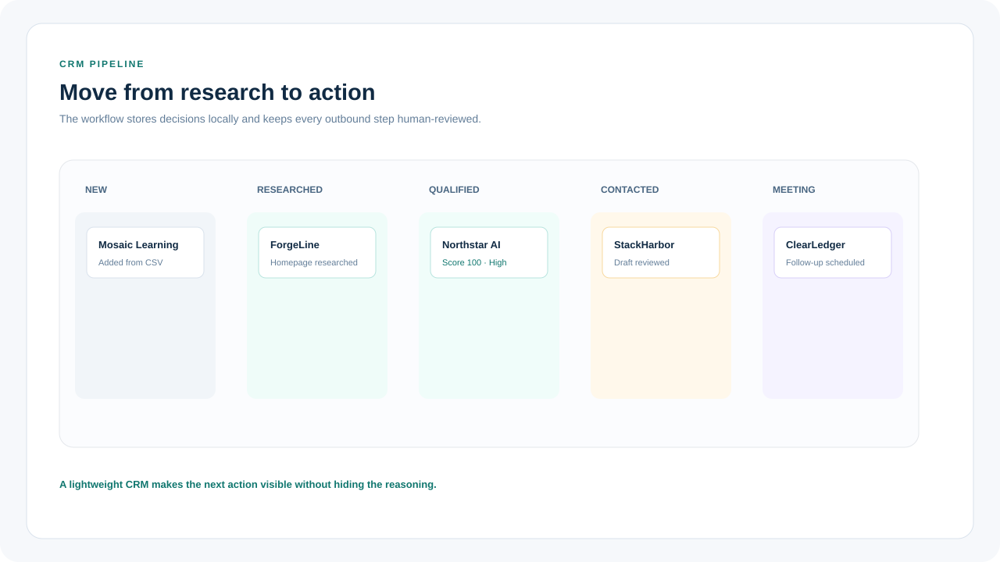
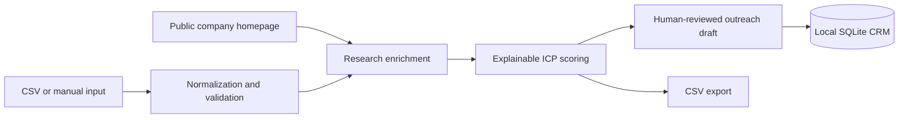

# OpsPilot

**AI-assisted lead research and workflow automation for early-stage teams.**

OpsPilot turns scattered account research into a transparent, reviewable go-to-market workflow. It imports leads, adds public company context, scores each account against a visible ideal customer profile, prepares personalized outreach drafts, and tracks the pipeline in a lightweight local CRM.

**[Live demo](https://opspilot-bmnuqoekeijj7opqkcrv5s.streamlit.app/)** · **[Product walkthrough](#product-walkthrough)** · **[Architecture](#architecture)**



> A recruiter should be able to see the product decision, the evidence behind it, and the next action before reading the implementation.

The application is designed as a portfolio demonstration of practical AI operations and product judgment. It works without an API key and ships with synthetic contacts, so anyone can explore the complete workflow safely. A separately configured workspace deployment can add Google OIDC sign-in and an explicitly approved Gmail batch sender.

## Why this project exists

Early-stage teams often manage account research, qualification, outreach preparation, and CRM updates across separate spreadsheets and browser tabs. Automation can save time, but opaque rankings and unsupervised outbound messages introduce new risks.

OpsPilot keeps the useful automation while making the decision process visible:

- every score includes its reasons and missing evidence;
- public website research is limited to URLs supplied by the user;
- the public demo keeps outreach in draft or simulation mode;
- data can be imported and exported as CSV;
- the local CRM uses SQLite and requires no external account.

## Product walkthrough

1. **Import** accounts from CSV or a manual form.
2. **Research** supplied company homepages for relevant public context.
3. **Prioritize** accounts using adjustable industry, size, buyer, intent, and completeness weights.
4. **Explain** why an account is high, medium, or low priority and what should be verified next.
5. **Draft** contextual outreach for human review.
6. **Track** status in a lightweight pipeline and export the result.

### Explainable prioritization



OpsPilot exposes the score components and research gaps instead of returning an unexplained ranking. This is useful when an operations or product team needs to challenge an assumption before acting on it.

### Lightweight CRM handoff



The final step keeps the workflow connected to execution: each account has a visible status, a review history, and a next action without requiring a full CRM vendor setup.

## Architecture



The workflow separates data intake, enrichment, scoring, outreach, and storage into small Python modules. This makes the business rules easy to inspect and change.

## Run locally

```bash
git clone https://github.com/XiaoChen-UChicago/OpsPilot.git
cd OpsPilot
python -m venv .venv
source .venv/bin/activate
pip install -r requirements.txt
streamlit run app.py
```

Open `http://localhost:8501`. The synthetic demonstration dataset loads automatically.

## Online demo

Open the hosted Streamlit demo: [opspilot-bmnuqoekeijj7opqkcrv5s.streamlit.app](https://opspilot-bmnuqoekeijj7opqkcrv5s.streamlit.app/).

The demo uses synthetic contacts and keeps outreach in draft or simulation mode for human review. See [`docs/DEPLOYMENT.md`](docs/DEPLOYMENT.md) for the optional authenticated Google/Gmail workspace deployment.

## CSV schema

| Field | Purpose |
| --- | --- |
| `company` | Required account name |
| `website` | Optional public homepage |
| `contact_name`, `title`, `email` | Contact context for review |
| `industry`, `employee_count`, `country` | Ideal customer profile inputs |
| `description` | Company and workflow context |
| `source` | Where the account originated |

## Scoring model

The default score uses five inspectable components:

| Component | Default weight |
| --- | ---: |
| Target industry | 25 |
| Preferred company size | 20 |
| Buyer relevance | 20 |
| Automation or scaling signal | 25 |
| Profile completeness | 10 |

Users can change the weights and company-size range in the interface. This is a prioritization heuristic rather than a predictive model; the product shows research gaps to prevent the score from being treated as ground truth.

## Responsible-use choices

- The included contacts and companies are synthetic.
- the public demo does not send messages or automate high-volume outreach;
- authenticated workspace mode limits approved batches to 20 messages and keeps the Gmail access token in memory;
- Users are prompted to verify company claims and recipients before using a draft.
- Invalid email addresses are removed during normalization.
- Local CRM data and secrets are excluded from version control.

## Roadmap

- Add pluggable enrichment providers with field-level provenance.
- Compare rule-based rankings with LLM-assisted rankings on a labeled evaluation set.
- Add duplicate-company resolution and change history.
- Add configurable approval stages for team workflows.
- Package the workflow as an API for CRM integrations.

## Repository guide

- `app.py` — Streamlit product interface
- `opspilot/enrichment.py` — public homepage research
- `opspilot/scoring.py` — explainable prioritization rules
- `opspilot/outreach.py` — review-ready draft generation
- `opspilot/storage.py` — local SQLite CRM
- `data/sample_leads.csv` — synthetic demonstration data
- `docs/` — product and architecture decisions

## Author

Built by **Xiao Chen**, a University of Chicago student studying Computational and Applied Mathematics and Computer Science, with interests in AI engineering, product strategy, and practical workflow automation.

## License

MIT


